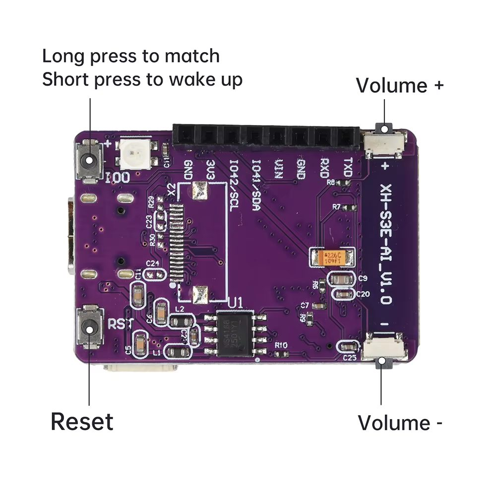
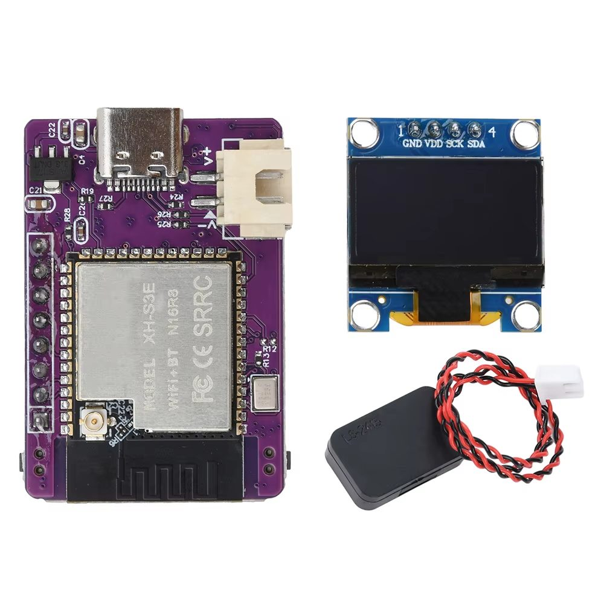

# SparkleIoT XH-S3E-AI V1.0



A tiny (39×26×10 mm) white-label ESP32-S3 voice kit board sold by many AliExpress and Taobao sellers as a "Xiaozhi AI voice kit", usually bundled with a 0.96"/1.3" I2C OLED and a 4Ω/2W speaker. The carrier board is unbranded — the PCB marking to look for is `XH-S3E-AI_V1.0`. Search for `XH-S3E-AI` on AliExpress or Taobao to find current listings.



The board is built around the **Sparkleiot XH-S3E** module (ESP32-S3-WROOM-1 compatible, N16R8 — 16MB flash, 8MB OPI PSRAM, FCC ID 2BCLR-XH-S3E) made by Shenzhen Sparkleiot Technology Co., Ltd. The module shield reads `MODEL XH-S3E / WiFi+BT N16R8 / FC CE SRRC`. Sparkleiot makes the module — the carrier board itself is unbranded.

## Hardware

- MCU: ESP32-S3 N16R8
- Display: 128×64 I2C OLED (SDA GPIO41, SCL GPIO42) — 0.96" SSD1306 or 1.3" SH1106 depending on the kit
- Audio: I2S microphone (WS GPIO4, SCK GPIO5, DIN GPIO6), I2S speaker (DOUT GPIO7, BCLK GPIO15, LRCK GPIO16), amplifier enable on GPIO17
- Buttons: BOOT (GPIO0) — short press wakes, long press opens Wi-Fi config mode; volume up/down (GPIO40/39)
- LED: GPIO48
- Battery: 2-pin JST (V+/V−) with USB-C charging
- Header: GND, 3V3, IO42/SCL, IO41/SDA, VIN, GND, RXD, TXD

## Build

```bash
idf.py set-target esp32s3
idf.py menuconfig   # Xiaozhi Assistant -> Board Type -> XH-S3E-AI V1.0, select your OLED type
idf.py build flash
```
